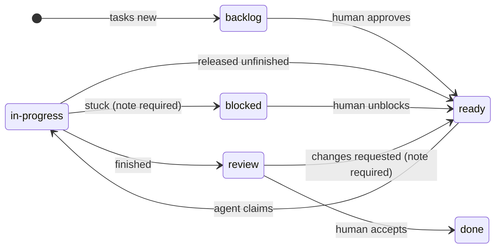

# task-queue-skill

**A file-based task queue for coding agents, packaged as the `task-queue` agent skill.**

[](https://github.com/jklutka/task-queue-skill/actions/workflows/test.yml)
[](LICENSE)


Most work handed to coding agents lives only in a chat window: the plan,
who is doing what and what is left all disappear when the session ends. This
project replaces that with a written queue in your repository that you and
your agents (Claude Code, Codex or both) share.

- **One task, one Markdown file.** Plain text you can read, edit, diff, review and commit.
- **The folder is the state.** `backlog/` → `ready/` → `in-progress/` → `review/` → `done/`, plus `blocked/`. `ls` is your dashboard.
- **Humans approve, agents execute.** Only a human moves work into `ready/` or `done/`; agents claim, finish or flag it.
- **A helper keeps it honest.** One small Python file creates, moves, lists and validates tasks, so no one hand-edits folders or bookkeeping fields.
- **Installed the same way everywhere.** The skill copies tested, versioned files into any project and wires them into `AGENTS.md` and `CLAUDE.md`. It doesn't generate new code for each project.

---

## Contents

- [How it works](#how-it-works)
- [Quick start](#quick-start)
- [Installing the skill](#installing-the-skill)
- [Setting up a project](#setting-up-a-project)
- [The `tasks` helper](#the-tasks-helper)
- [Task file format](#task-file-format)
- [Lifecycle rules](#lifecycle-rules)
- [Working with agents](#working-with-agents)
- [Upgrading](#upgrading)
- [Design principles](#design-principles)
- [Repository layout](#repository-layout)
- [Contributing](#contributing)
- [License](#license)

## How it works

```
tasks/
├── README.md        rules for agents
├── _template.md     copied by `tasks new`
├── backlog/         drafted, not approved
├── ready/           approved, waiting to be picked up
├── in-progress/     claimed by exactly one agent
├── review/          finished, waiting on human review
├── blocked/         failed or needs a decision
└── done/            accepted
```



Any task can also be shelved back to `backlog/`.

You still plan in conversation, but the plan ends up as task files. An agent
asks the queue for the next task that is assigned to it, ready, and has all of
its dependencies done. It claims that task, does the work and moves it to
`review/`. You review it and accept it. Every move appends a line to the task's
log, so the file records its own history.

## Quick start

```bash
git clone https://github.com/jklutka/task-queue-skill.git
cd task-queue-skill

# Install the queue into one of your projects
python skill/task-queue/scripts/install.py --project ../my-project

cd ../my-project
scripts/tasks new "Add retry with backoff to the sync job" --agent claude --priority p1
scripts/tasks list
```

On Windows, use `py` (or `python`) and `scripts\tasks`. Every command works the
same in PowerShell, cmd, WSL, Linux and macOS.

## Installing the skill

Requirements: Python 3.10 or newer. Nothing else.

Link the skill folder into your user-level skills folder rather than copying
it, so that a `git pull` of this repo upgrades the installed skill.

The skill follows the open [Agent Skills](https://agentskills.io/specification)
format, so the same folder works in Claude Code and Codex. Only the skills
folder differs:

| Agent | Skills folder |
| ----- | ------------- |
| Claude Code | `~/.claude/skills/` |
| Codex | `~/.agents/skills/` |

**Linux, macOS or WSL:**

```bash
ln -s "$PWD/skill/task-queue" ~/.claude/skills/task-queue   # Claude Code
ln -s "$PWD/skill/task-queue" ~/.agents/skills/task-queue   # Codex
```

**Windows** (PowerShell; a junction needs no admin rights):

```powershell
New-Item -ItemType Junction -Path "$HOME\.claude\skills\task-queue" -Target "$PWD\skill\task-queue"   # Claude Code
New-Item -ItemType Junction -Path "$HOME\.agents\skills\task-queue" -Target "$PWD\skill\task-queue"   # Codex
```

Create the skills folder first if it doesn't exist yet. Other agents that
support Agent Skills work the same way. The helper and the `AGENTS.md`
instructions work for any agent that can run a shell command, even without
skill support.

## Setting up a project

Once the skill is installed, ask your agent:

> Set up the task queue in this project.

The skill runs [`scripts/install.py`](skill/task-queue/scripts/install.py), which does the
following in order:

1. **Checks for conflicts.** If `tasks/` or `scripts/tasks*` already exist and
   weren't created by this skill, it stops and the agent asks you what to do.
2. **Installs the queue.** It creates `tasks/` with its six folders and copies
   `scripts/tasks.py` with its `scripts/tasks` (sh) and `scripts/tasks.cmd`
   (Windows) shims.
3. **Wires up `AGENTS.md`.** It adds a short task-queue section between
   `<!-- task-queue:start vN -->` and `<!-- task-queue:end -->` markers and
   leaves every other line alone.
4. **Wires up `CLAUDE.md`.** Codex reads `AGENTS.md` directly. For Claude
   Code, it adds an `@AGENTS.md` import, so both agents read the same
   instructions from one source.
5. **Offers a Stop hook.** This optional hook runs `tasks validate` at the end
   of every turn and sends any problems back to the agent. It is available for
   Claude Code (merged into `.claude/settings.json`) and Codex (merged into
   `.codex/hooks.json`). Your other settings are kept.
6. **Validates and reports.** It lists every file it created or changed. It
   never commits anything.

You can run the installer directly too:

| Command | Effect |
| ------- | ------ |
| `python scripts/install.py --project <dir> --check` | Reports installed versions, hooks and conflicts; changes nothing |
| `python scripts/install.py --project <dir>` | Installs or upgrades |
| `... --claude-hook` | Also merges the Stop hook into `.claude/settings.json` |
| `... --codex-hook` | Also merges the Stop hook into `.codex/hooks.json` |
| `... --adopt` | Replaces unmarked `tasks/README.md` and `scripts/tasks*` after you agree; task files are never touched |

Run these from the skill folder (`skill/task-queue/`), or give the full path to
`install.py`.

Exit codes: `0` success or up to date, `1` error, failed validation or (with
`--check`) install needed, `2` stopped for a human decision.

## The `tasks` helper

Run from anywhere inside the project. It finds the `tasks/` folder by itself;
pass `--root <dir>` to override.

| Command | What it does |
| ------- | ------------ |
| `tasks init` | Creates `tasks/`, its six folders, `README.md` and `_template.md`. Safe to re-run; never overwrites. |
| `tasks new "<title>" --agent <claude\|codex\|either> [--priority p1\|p2\|p3] [--depends 0039,0040]` | Creates the next task in `backlog/` and prints its path. |
| `tasks move <id> <state> [--by <who>] [--note "<text>"]` | Moves a task if the transition is allowed, updates the bookkeeping fields and appends a log line. |
| `tasks list [--state <s>] [--agent <a>]` | Shows a table sorted by state, then priority, then ID. |
| `tasks next --agent <claude\|codex>` | Prints the next eligible task ID, or exits 1 with no output if none is eligible. |
| `tasks validate` | Prints one line per problem; exits 0 only when the queue is clean. |

A typical round trip:

```bash
scripts/tasks new "Add retry with backoff" --agent claude --priority p1    # tasks/backlog/0001-add-retry-with-backoff.md
#   ...fill in Goal, Context, Done when and Out of scope...
scripts/tasks move 0001 ready                                             # human approves
scripts/tasks next --agent claude                                         # 0001
scripts/tasks move 0001 in-progress --by claude                           # agent claims
scripts/tasks move 0001 review --by claude --note "retry added, tests pass"
scripts/tasks move 0001 done                                              # human accepts
```

## Task file format

Each task is `tasks/<state>/NNNN-short-slug.md`. The four-digit ID is never
reused, and the file name never changes as the task moves.

```markdown
---
id: 0042
title: Add retry with backoff to the sync job
agent: claude
review_by:
priority: p2
depends_on: [0039]
model: default
created: 2026-10-13
claimed_by:
started:
attempts: 0
---

## Goal
Sync jobs survive transient network failures without manual restarts.

## Context
sync/job.py; see 0039 for the new HTTP client.

## Done when
- [ ] Failed requests retry up to 5 times with exponential backoff
- [ ] Tests cover success after retry and final failure

## Out of scope
The scheduler and the HTTP client itself.

## Log
- 2026-10-13 09:12 human: created in backlog
```

| Field | Required | Values |
| ----- | -------- | ------ |
| `id` | yes | 4 digits, matching the file name |
| `title` | yes | text |
| `agent` | yes | `claude`, `codex`, `either` |
| `priority` | yes | `p1` (most urgent), `p2`, `p3` |
| `created` | yes | `YYYY-MM-DD`, set by `tasks new` |
| `depends_on` | no | list of IDs that must be in `done/` first |
| `review_by` | no | `claude`, `codex`, `human` (stored for future use) |
| `model` | no | `default`, `light`, `heavy` |
| `claimed_by`, `started`, `attempts` | managed | written by `tasks move` only |

## Lifecycle rules

| From | To | Who | Rule |
| ---- | -- | --- | ---- |
| `backlog/` | `ready/` | human | Goal, Done when and Out of scope must be filled |
| `ready/` | `in-progress/` | agent | `--by claude` or `--by codex`; the task must be eligible for that agent |
| `in-progress/` | `review/` | agent | |
| `in-progress/` | `blocked/` | agent | `--note` required |
| `in-progress/` | `ready/` | agent | released unfinished, e.g. a usage limit was hit |
| `review/` | `done/` | human | |
| `review/` | `ready/` | human | `--note` with the requested changes |
| `blocked/` | `ready/` | human | same checks as backlog → ready |
| any | `backlog/` | anyone | shelved |

Claiming a task sets `claimed_by` and `started` and increments `attempts`.
Releasing a task back to `ready/` clears `claimed_by` and `started` but keeps
`attempts`. Moves use an atomic rename, so two agents can't claim the same task.
`tasks validate` catches duplicate IDs, mismatched file names, missing or
invalid fields, unknown dependencies, missing sections and stray files.

## Working with agents

The section the skill adds to `AGENTS.md` tells every agent to:

- check `tasks/ready/` for work assigned to it or to `either` before starting
- break multi-step work into task files in `tasks/backlog/` instead of keeping
  the plan only in conversation
- **true up** after each major step: move finished work to `review/`, record
  blockers in `blocked/`, add newly found work to `backlog/`, then run
  `tasks validate`
- never move tasks into `ready/` or `done/`

You can also ask for a true-up at any point ("true up the task queue"). The
optional Stop hook makes the true-up hard to skip: if the queue is invalid when
the agent tries to finish, it gets the problems back and fixes them first. The
hook checks the `stop_hook_active` flag, so an unfixable problem can't trap the
agent in a loop.

**Codex note:** Codex runs a project's hooks only after you review and trust
them. Run `/hooks` in Codex once after installing the hook.

## Upgrading

Every installed copy carries a version marker in three places: the `AGENTS.md`
start marker, the first line of `tasks/README.md` and `__version__` in
`scripts/tasks.py`. To upgrade, `git pull` this repo and ask the agent to
upgrade the task queue (or re-run `install.py`). The upgrade replaces only the
marked `AGENTS.md` section, the README, the template and the helper. Your task
files are never touched, and running the installer again changes nothing.

## Design principles

- **Plain files over services.** No database, server or account. The queue is
  part of the repository and is reviewed like code.
- **Small and boring.** The helper is one standard-library Python file. It
  never runs git; committing is your call or a future runner's.
- **Copy, don't regenerate.** Agents install the tested files byte for byte
  instead of rewriting them per project.
- **Humans hold the gates.** Approval (`ready/`) and acceptance (`done/`) are
  human decisions.
- **Cross-platform by default.** Built on `pathlib`, with sh and `.cmd` shims,
  and tested on Linux, macOS and Windows.

Out of scope for now: a runner that drives agents headlessly, git automation,
scheduling and automatic cross-review.

## Repository layout

```
task-queue-skill/
├── docs/spec.md                     full feature specification
├── skill/task-queue/                the skill: link this folder into your skills folder
│   ├── SKILL.md                     triggers and setup, upgrade and true-up steps
│   ├── VERSION                      current pattern version
│   ├── scripts/install.py           mechanical install and upgrade
│   └── assets/                      copied into projects verbatim
│       ├── tasks/README.md          agent-facing rules
│       ├── tasks/_template.md
│       ├── scripts/tasks.py         the helper
│       ├── scripts/tasks            sh shim
│       ├── scripts/tasks.cmd        Windows shim
│       ├── agents-section.md        the AGENTS.md section
│       └── hooks/                   optional Stop hooks for Claude Code and Codex
├── tests/                           unittest suite, one test per acceptance criterion
└── tasks/, scripts/, AGENTS.md, CLAUDE.md
                                     this repo's own queue, installed with the skill
```

## Contributing

Issues and pull requests are welcome. See [CONTRIBUTING.md](CONTRIBUTING.md)
for the development setup, test command and release steps, and
[CHANGELOG.md](CHANGELOG.md) for version history.

```bash
python -m unittest discover -s tests -v
```

## License

[MIT](LICENSE) © 2026 Justin Klutka
